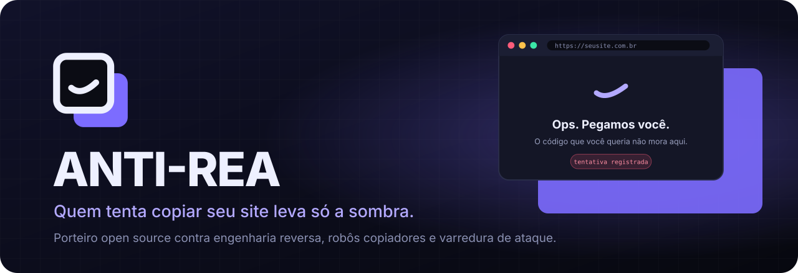
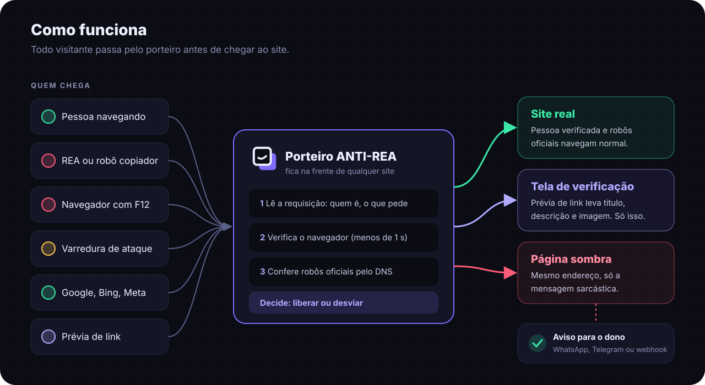

<div align="center">



<br>

[](#roadmap)
[](LICENSE)
[](#)
[](#install-in-3-steps)

**[Português](README.md)** · **[Docs (pt-BR)](docs/README.md)**

</div>

> [!NOTE]
> **ANTI-REA is under construction.** This page describes how the tool will work. Check the
> [roadmap](#roadmap) for what already runs.

## In one sentence

ANTI-REA is a **gatekeeper** that sits in front of your website. Real people browse normally.
Reverse-engineering tools, copier bots and attack scanners land on a **shadow page** with a sarcastic
message, at the same address, and you get an **instant alert** on your phone.

Works with any site (Next.js, WordPress, Laravel, plain HTML). No changes to your code.

## How it works



1. **Every visitor goes through the gatekeeper**, which reads who is asking and what for.
2. **First visit: a sub-second browser check.** Visitors who pass get a signed pass for days.
3. **Official bots** (Google, Meta, link previews) are verified by reverse DNS or published IP ranges.
4. **Caught visitors** get the shadow page. You get an alert (WhatsApp, Telegram or webhook).

It also locks source maps, `.env`, `.git` and backups for everyone, and ships a **self-scan** that
shows what a curious visitor can see of your site.

> [!IMPORTANT]
> No tool can stop 100% of copying of what the browser receives. ANTI-REA raises the cost, reports
> and deceives. It does not make your site invisible.

## Install in 3 steps

```bash
npx anti-rea init     # wizard: asks your site address and alert channel
npx anti-rea start    # gatekeeper up on :8080
```

Then point your domain to the gatekeeper instead of the site. Docker image:
`ghcr.io/jeipidevs/anti-rea`.

## Roadmap

- [x] Project, brand and docs
- [ ] Reverse proxy with server-side rules
- [ ] First-visit browser check
- [ ] Official bot verification
- [ ] Configurable shadow page
- [ ] Alerts: WhatsApp (Evolution API), Telegram, webhook
- [ ] `npx anti-rea init` wizard
- [ ] Published Docker image
- [ ] Self-scan
- [ ] Log panel

## Responsible use

ANTI-REA defends. The shadow page never runs anything against the visitor. The self-scan only runs on
domains you prove you control and only reads. IP addresses are personal data (GDPR, LGPD): mention
the collection in your privacy policy.

## Credits

Built by studying the logic of [REA (Reverse Engineer Anything)](https://github.com/morluto/rea) to
learn how to defend against it. **Independent project**, not affiliated with REA or its authors.
MIT licensed. Made in Brazil by JPStudio.
