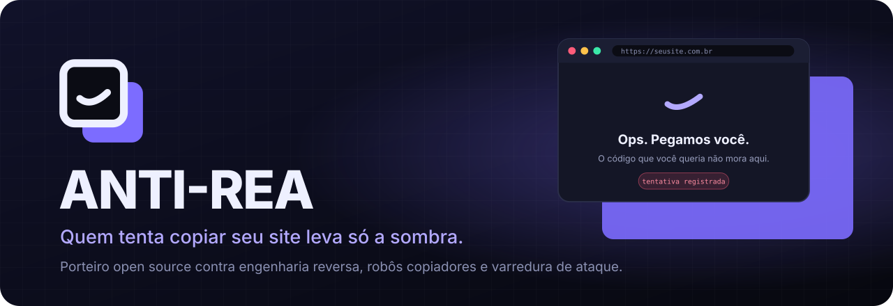
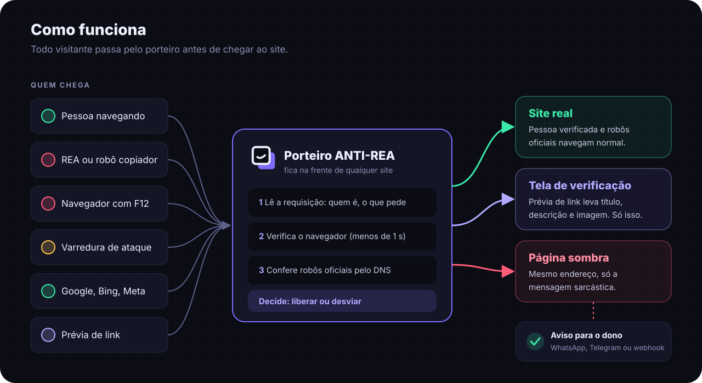
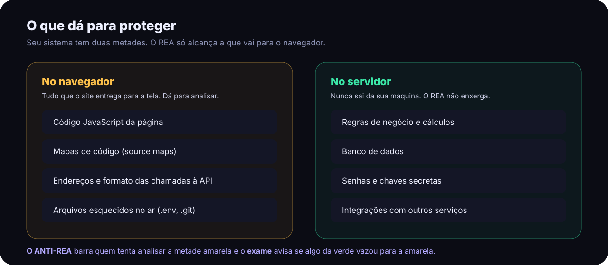
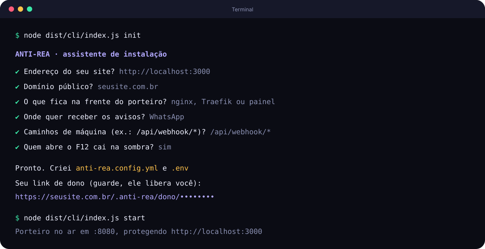
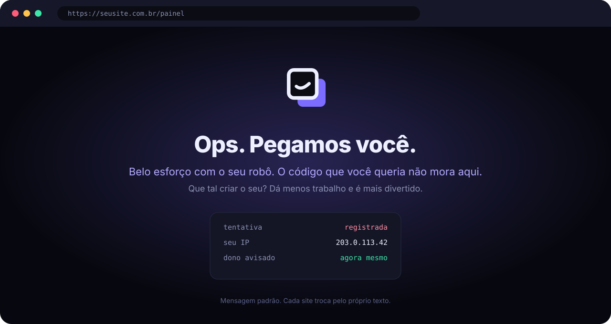
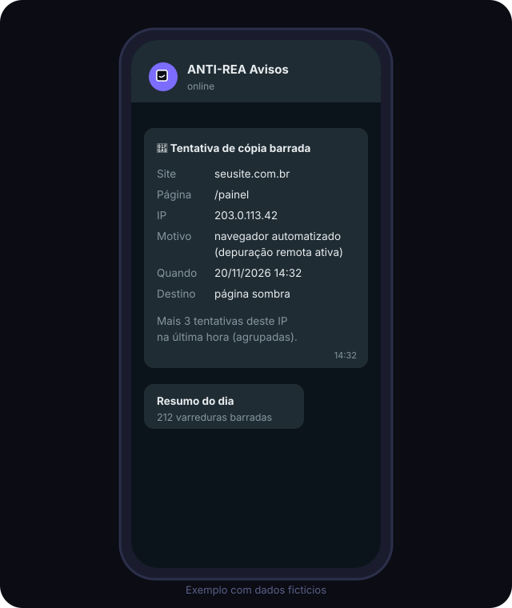
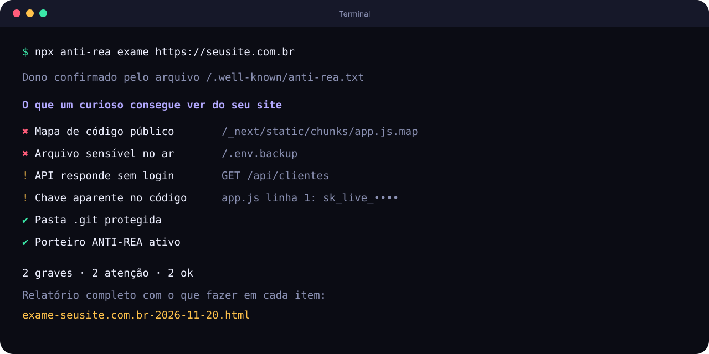

<div align="center">



<br>

[](#roteiro)
[](LICENSE)
[](#)
[](#instalar-em-3-passos)
[](CONTRIBUTING.md)

**[Documentação](docs/README.md)** · **[Instalar](#instalar-em-3-passos)** · **[Perguntas frequentes](docs/perguntas-frequentes.md)** · **[English](README.en.md)**

</div>

<br>

> [!NOTE]
> **Versão 0.1: o porteiro funciona. O exame do próprio site e o painel vêm a seguir.**
> Acompanhe o [roteiro](#roteiro) para ver o que já está pronto. Nada aqui promete o que ainda não roda.

## Em uma frase

O ANTI-REA é um **porteiro** que fica na frente do seu site. Gente de verdade entra normal. Quem chega
com ferramenta de engenharia reversa, robô copiador ou varredura de ataque cai numa **página sombra**
com uma mensagem sarcástica, no mesmo endereço. E você recebe um **aviso no celular** na hora.

Funciona com qualquer site: Next.js, WordPress, Laravel, HTML simples ou o que você tiver. Não precisa
mexer em uma linha do seu código; o WordPress só pede alguns caminhos isentos (veja
[Configurar](docs/03-configurar.md#wordpress-feeds-e-cdn)).

## O que ele faz

<table>
<tr>
<td width="33%" valign="top">
<br>
<b>Porteiro na frente do site</b><br>
Confere cada visitante antes de deixar entrar. Em menos de um segundo, só na primeira visita.
</td>
<td width="33%" valign="top">
<br>
<b>Página sombra</b><br>
Robô copiador, navegador automatizado e quem abre o F12 veem só a mensagem sarcástica. Com a
configuração padrão, o REA ligado a uma aba visível também cai: a guarda confere a cada 0,5 s (até
uns 0,6 s numa página muito ocupada; num aparelho muito lento, ela recua para 1 s e depois 1,5 s). A
inspeção curta dele caiu 20 de 20 vezes, mas em 2 já tinha lido a página
(<a href="docs/perguntas-frequentes.md">o que ele ainda leva</a>).
</td>
<td width="33%" valign="top">
<br>
<b>Aviso na hora</b><br>
WhatsApp, Telegram ou webhook, com IP, página e motivo. Tentativas repetidas vêm agrupadas.
</td>
</tr>
<tr>
<td width="33%" valign="top">
<br>
<b>Arquivos sensíveis trancados</b><br>
Ficam bloqueados para todo mundo, em qualquer pasta: mapas de código (<code>.map</code>);
<code>.env</code>, <code>.env.*</code> e <code>.envrc</code>; <code>.git</code>, <code>.svn</code>,
<code>.hg</code> e <code>.DS_Store</code>; <code>.htaccess</code>, <code>.htpasswd</code>,
<code>.npmrc</code>, <code>.git-credentials</code>, <code>.ssh</code>, <code>.aws</code> e
<code>wp-config.php.*</code>; arquivos terminados em <code>.bak</code>, <code>.old</code>,
<code>.orig</code>, <code>.save</code>, <code>~</code>, <code>.swp</code>, <code>.swo</code>,
<code>.sql</code> e <code>.sql.gz</code>; compactados (<code>.zip</code>, <code>.tar</code>,
<code>.tar.gz</code>, <code>.tgz</code>, <code>.gz</code>, <code>.7z</code>, <code>.rar</code>) com nome
que começa por <code>backup</code> ou <code>bkp</code> e, na raiz, os chamados <code>site</code>,
<code>www</code>, <code>web</code>, <code>html</code>, <code>public_html</code>, <code>htdocs</code>,
<code>wwwroot</code>, <code>db</code>, <code>database</code> ou <code>dump</code>
(<a href="docs/03-configurar.md#arquivos-trancados">detalhes</a>).
</td>
<td width="33%" valign="top">
<br>
<b>Exame do seu site</b><br>
Vai mostrar o que um curioso consegue ver do seu site antes que alguém de fora descubra. Vem a seguir.
</td>
<td width="33%" valign="top">
<br>
<b>Painel de registro</b><br>
Hoje as tentativas ficam num registro (JSONL) na sua máquina. A tela para ler esse registro vem a
seguir.
</td>
</tr>
</table>

## Como funciona



1. **Todo visitante passa pelo porteiro.** Ele olha quem está pedindo e o que está pedindo.
2. **Na primeira visita, o navegador é verificado** por menos de um segundo. Quem passa ganha um
   passe e navega livre por dias.
3. **Robôs oficiais** (Google, Bing, Apple e Meta) são confirmados pelo endereço oficial deles e
   passam direto. Seu anúncio e sua busca continuam funcionando. Robôs de prévia de link (WhatsApp,
   Telegram e outros) recebem a tela de verificação, que já leva o título, a descrição e a imagem
   do site.
4. **Quem é pego** recebe a página sombra no mesmo endereço, sem redirecionar. Você recebe o aviso.

Quer entender cada parte com calma? Leia [O que é o ANTI-REA](docs/01-o-que-e.md).

## O que dá para proteger (a verdade, sem enfeite)



A lógica que roda no servidor nunca vai para o navegador. Ferramentas como o REA só alcançam o que o
site entrega para a tela. O ANTI-REA **barra quem tenta analisar** essa parte, e o **exame** (que vem a
seguir) vai avisar se algo do servidor vazou para ela.

> [!IMPORTANT]
> Nenhuma ferramenta impede 100% a cópia do que o navegador recebe. Uma pessoa paciente, com um
> navegador comum, sempre consegue salvar o que a página mostra. O ANTI-REA **encarece, denuncia e
> engana** quem tenta. Ele não deixa seu site invisível, e desconfie de quem prometer isso.

## Instalar em 3 passos



> [!NOTE]
> O pacote `anti-rea` ainda não está no npm nem a imagem no GHCR: os dois saem junto com a primeira
> versão publicada. Até lá, rode a partir deste repositório, como explica [Instalar](docs/02-instalar.md).

**1. Rode o assistente.** Ele pergunta o endereço do seu site, o que fica na frente dele e onde você
quer os avisos, e escreve a configuração sozinho.

```bash
npx anti-rea init
```

**2. Ligue o porteiro.**

```bash
npx anti-rea start
```

**3. Aponte o seu domínio para o porteiro** em vez do site. Pronto.

Prefere Docker? Use este `docker-compose.yml`. A imagem `ghcr.io/jeipidevs/anti-rea` sai junto com a
primeira versão publicada; até lá, construa a sua a partir deste repositório com
`docker build -t anti-rea .` e troque a linha `image:` por `image: anti-rea`.

```yaml
services:
  anti-rea:
    image: ghcr.io/jeipidevs/anti-rea:latest
    restart: unless-stopped
    ports:
      - "8080:8080"
    env_file: .env
    # Horário dos avisos e do resumo do dia: sem TZ, o contêiner fica em UTC.
    # environment:
    #   - TZ=America/Sao_Paulo
    volumes:
      - ./anti-rea.config.yml:/app/anti-rea.config.yml:ro
      - ./registro:/app/registro
```

A imagem roda com um usuário sem poder de administrador (uid 1000). Crie a pasta do registro com esse
dono antes de subir, senão o porteiro sobe mas não consegue guardar as tentativas:

```bash
mkdir -p registro && sudo chown 1000:1000 registro
docker compose up -d
```

Com um proxy na frente (nginx, Traefik, EasyPanel, Cloudflare), ligue `trustProxy` e deixe a porta do
porteiro alcançável só pelo proxy (`"127.0.0.1:8080:8080"`). O passo a passo de cada caso está em
[Instalar](docs/02-instalar.md#último-passo-apontar-o-domínio-para-o-porteiro).

No Docker, o assistente e o comando `dono` rodam com Node ou pela própria imagem (veja
[Instalar](docs/02-instalar.md#jeito-2-docker)). Depois de mudar o `.env`, rode `docker compose up -d`:
o `docker compose restart` não relê o `.env`.

Passo a passo com imagem para cada tipo de hospedagem (VPS, EasyPanel, Coolify, nginx, Cloudflare):
[Instalar](docs/02-instalar.md).

## A página sombra



Vem com uma mensagem padrão em português e inglês. Troque pelo seu texto, sua cor e seu logo em
[Página sombra](docs/04-pagina-sombra.md).

## O aviso no seu celular

<div align="center">

</div>

Só tentativa de cópia e ataque direcionado (scanner como sqlmap ou nikto apontado para o seu site)
viram aviso. A varredura automática que todo site recebe
o dia inteiro fica só no registro, com um resumo diário opcional. Durante um ataque de muitos IPs, os
avisos param em 6 a cada 5 minutos e o resto chega agrupado. Seu celular não vira sirene.
Configurar: [Avisos](docs/05-avisos.md).

## O exame do seu site

> [!NOTE]
> O exame ainda não existe na versão 0.1. Esta seção mostra como ele vai funcionar.



```bash
npx anti-rea exame https://seusite.com.br
```

O exame vai usar a mesma lógica das ferramentas de engenharia reversa, só que a seu favor. Ele só vai
rodar em site que você prova ser seu, e só vai fazer leitura: nunca altera nada. Detalhes em [Exame](docs/06-exame.md).

## Perguntas rápidas

<details>
<summary><b>Meu cliente pode cair na página sombra por engano?</b></summary>

Quem navega normal, não. Quem abre as ferramentas de desenvolvedor (F12) cai, por padrão, porque esse
é o mesmo sinal que o REA deixa. Você pode mudar isso por site. Você e sua equipe usam o
[link de dono](docs/07-modo-dono.md) e não caem na página sombra (os arquivos trancados continuam
trancados para todo mundo).
</details>

<details>
<summary><b>Vai atrapalhar o Google ou meus anúncios?</b></summary>

Não. Google, Bing, Apple e Meta são confirmados pelo endereço oficial de cada um e passam direto. A
prévia do WhatsApp e de outros apps recebe o título, a descrição e a imagem do site. O DuckDuckGo não
tem como ser conferido e vê só essa prévia. Veja [Robôs oficiais](docs/08-robos-oficiais.md).
</details>

<details>
<summary><b>Meu site fica mais lento?</b></summary>

Só a primeira visita tem a verificação, de menos de um segundo. Depois disso o visitante navega com
um passe e não sente diferença. A página que o seu site manda comprimida (gzip, deflate ou br)
continua comprimida, com a guarda.
</details>

<details>
<summary><b>E os webhooks de pagamento e o app de celular que chamam minha API?</b></summary>

Você lista esses caminhos como isentos. O assistente pergunta por eles na instalação.
`robots.txt`, sitemaps, o manifesto do PWA e `/.well-known/` já passam sozinhos. Veja
[Configurar](docs/03-configurar.md#caminhos-públicos-padrão).
</details>

<details>
<summary><b>Substitui um firewall ou proteção contra DDoS?</b></summary>

Não. O ANTI-REA cuida de cópia e análise. Use junto com a proteção que você já tem.
</details>

Mais perguntas: [Perguntas frequentes](docs/perguntas-frequentes.md) · Termos difíceis: [Glossário](docs/glossario.md)

## Roteiro

- [x] Projeto, marca e documentação
- [x] Porteiro (proxy reverso) com regras no servidor
- [x] Verificação do navegador na primeira visita
- [x] Confirmação de robôs oficiais
- [x] Página sombra configurável
- [x] Avisos: WhatsApp (Evolution API), Telegram e webhook
- [x] Assistente `npx anti-rea init`
- [ ] Imagem Docker publicada
- [ ] Exame do próprio site
- [ ] Painel de registro

## Uso responsável

- O ANTI-REA **defende**. A página sombra nunca roda nada contra a máquina de quem tentou e nunca
  coleta além do que chega na requisição.
- O exame (que vem a seguir) só vai rodar em site que você prova controlar. Ele não serve para
  varrer site dos outros.
- **IP é dado pessoal** pela LGPD (e pelo GDPR). Se você usar o ANTI-REA, cite a coleta na política
  de privacidade do seu site. O registro apaga sozinho depois do prazo que você escolher.

## Contribuir

Ideias, correções e novos sinais de detecção são muito bem-vindos. Comece por
[CONTRIBUTING.md](CONTRIBUTING.md). Achou uma falha de segurança? Siga o [SECURITY.md](SECURITY.md)
e não abra issue pública.

## Créditos e licença

O ANTI-REA nasceu estudando a lógica do [REA (Reverse Engineer Anything)](https://github.com/morluto/rea),
para saber como uma análise acontece e como se defender dela. É um projeto **independente**, sem
ligação com o REA ou com seus autores.

Licença [MIT](LICENSE). Feito no Brasil pela JPStudio.

<div align="center">
<br>

</div>
