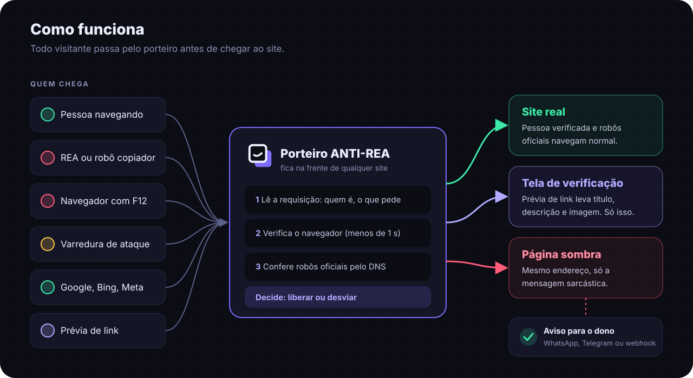

# O que é o ANTI-REA

## O problema

Existem ferramentas que abrem um site e desmontam ele por dentro. A mais completa hoje se chama
**REA** (Reverse Engineer Anything). Ela lê o código que o site manda para o navegador, encontra os
endereços da API, reconstrói o código original a partir dos mapas de código e monta um retrato de
como o sistema funciona.

Isso é útil para estudar, e é exatamente o que um concorrente usaria para copiar o seu sistema.

## A ideia

Pense num prédio com porteiro.

- O morador entra direto. O porteiro já conhece.
- Um visitante novo é olhado por um segundo e entra.
- Quem chega com pé de cabra não sobe. O porteiro manda para uma sala vazia com um bilhete
  debochado e liga para o síndico.

O ANTI-REA é esse porteiro. O **morador** é o visitante que já passou pela verificação. O **pé de
cabra** é o REA, o robô copiador, o navegador automatizado e a ferramenta de ataque. A **sala vazia**
é a página sombra. O **síndico** é você, avisado no celular.

## O que ele confere

**No servidor, a cada pedido:**
- se o pedido tem a cara de uma ferramenta conhecida (REA, wget, HTTrack, scanners de ataque);
- se está pedindo um mapa de código ou um arquivo sensível (`.env`, `.git`, backup);
- se está navegando rápido demais para ser gente;
- se está testando caminhos clássicos de ataque.

**No navegador, na primeira visita (menos de 1 segundo):**
- se o navegador é automatizado (robô pilotando um Chrome);
- se o navegador está em modo de depuração, que é como o REA se conecta. Abrir o F12 deixa o mesmo
  sinal, por isso quem abre o F12 também cai na sombra (dá para mudar).

## O que ele não é

- Não é firewall completo nem proteção contra DDoS. Use junto.
- Não deixa o site invisível. Veja [o que dá para proteger](../README.md#o-que-dá-para-proteger-a-verdade-sem-enfeite).
- Não contra-ataca. Ele defende, engana e avisa.

Próximo passo: [Instalar](02-instalar.md).
