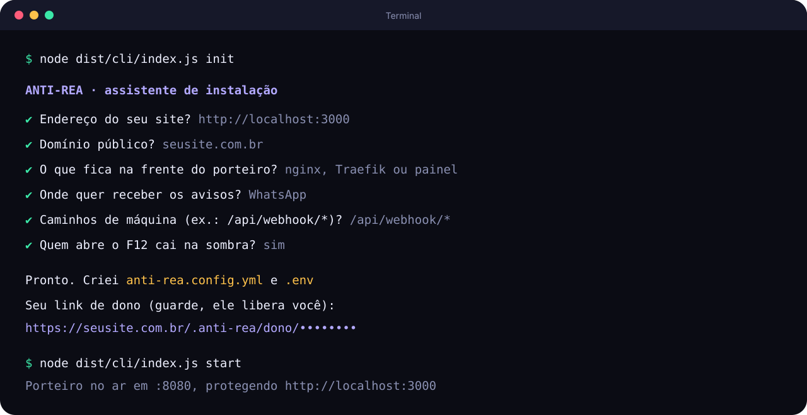

# Instalar

> [!NOTE]
> Versão 0.1.3: o pacote está no npm ([`anti-rea`](https://www.npmjs.com/package/anti-rea)) e a
> imagem Docker em `ghcr.io/jeipidevs/anti-rea`.

## Antes de começar

Você precisa de duas coisas:

1. **Onde o seu site roda hoje.** Por exemplo `http://localhost:3000` ou `http://meu-site:80` dentro
   da sua VPS. O porteiro vai buscar o site real ali.
2. **Node.js 22 ou mais novo**, ou **Docker**. Só com Docker, o assistente e o comando `dono` rodam
   pela própria imagem, como mostra o [Jeito 2](#jeito-2-docker).

## Jeito 1: assistente (o mais fácil)



```bash
npx anti-rea init
```

Rode na pasta onde a configuração vai morar. Para deixar o ANTI-REA instalado na máquina, use
`npm install -g anti-rea`: aí cada comando vira só `anti-rea` (por exemplo `anti-rea start`).

Responda as perguntas. Uma delas é o que fica na frente do porteiro (nada, um proxy como nginx,
Traefik, EasyPanel ou Coolify, ou a Cloudflare): é daí que sai o IP de cada visitante, então responda
com cuidado. No fim ele cria dois arquivos:

- `anti-rea.config.yml`: a configuração, com um comentário em português em cada linha.
- `.env`: as senhas dos canais de aviso e o segredo que assina os passes (`ANTI_REA_SECRET`, que
  precisa ter pelo menos 32 caracteres; à mão, gere com `openssl rand -base64 32`). **Nunca suba esse
  arquivo para o GitHub.**

Se a pasta já tem um `.env` (o do seu site, por exemplo), o assistente não mexe no que está lá: só
acrescenta no fim, sob a linha `# ANTI-REA`, as variáveis `ANTI_REA_` que faltam. As `ANTI_REA_` que
já existem ficam como estão, inclusive o segredo, então o link de dono continua o mesmo. Rodar de
novo não repete nada. O assistente só recusa quando `anti-rea.config.yml` já existe; para trocar a
configuração, rode o `init --forcar` (o `.env` continua sendo só completado).

Ele também mostra o seu [link de dono](07-modo-dono.md). Guarde num lugar seguro.

Depois, ligue:

```bash
npx anti-rea start
```

## Jeito 2: Docker

Crie a configuração com o assistente. O assistente e o comando `dono` rodam fora do porteiro: o
contêiner do porteiro não tem o `.env` dentro (ele chega pelo `env_file`) e não grava na pasta da
instalação. Com Node no servidor, use o `init` do passo acima. Sem Node, rode o assistente
pela imagem, na pasta onde a configuração vai morar:

```bash
docker run --rm -it --user "$(id -u):$(id -g)" -v "$PWD":/work -w /work ghcr.io/jeipidevs/anti-rea:latest node /app/dist/cli/index.js init
```

Ele cria `anti-rea.config.yml` e `.env` nessa pasta. No `upstream`, use o endereço do site visto de
dentro do contêiner (o nome do serviço e a porta), não `localhost`.

Depois, use este `docker-compose.yml` na mesma pasta:

```yaml
services:
  anti-rea:
    image: ghcr.io/jeipidevs/anti-rea:latest
    restart: unless-stopped
    ports:
      - "127.0.0.1:8080:8080"
    env_file: .env
    # Horário dos avisos e do resumo do dia: sem TZ, o contêiner fica em UTC.
    # environment:
    #   - TZ=America/Sao_Paulo
    volumes:
      - ./anti-rea.config.yml:/app/anti-rea.config.yml:ro
      - ./registro:/app/registro
```

A porta sai só para a própria máquina (`"127.0.0.1:8080:8080"`), o caso de um proxy na mesma máquina
(nginx ou Traefik, `trustProxy: true`), como na seção do [nginx](#com-nginx-na-frente): a porta do
porteiro só pode ser alcançada pelo proxy. No painel (EasyPanel, Coolify), não publique porta. Com a
Cloudflare ligada direto no porteiro, não use `127.0.0.1`: veja [Atrás da Cloudflare](#atrás-da-cloudflare).
Sem nada na frente (`trustProxy: false`), tire o `127.0.0.1:` para a porta aceitar conexões de fora.

O `restart: unless-stopped` religa o porteiro sozinho se ele cair ou se a máquina reiniciar: com ele
parado, o site fica fora do ar.

Ao parar (`docker compose down`, ou `Ctrl+C` fora do Docker), o porteiro deixa de aceitar conexões,
espera até 8 s os pedidos em andamento terminarem (o Docker encerra o processo em 10 s), fecha o que
sobrar e manda os avisos que estavam pendentes.

A imagem roda com um usuário sem poder de administrador (uid 1000). Crie a pasta do registro
antes e dê a ela esse dono, senão o porteiro sobe mas não consegue gravar as tentativas (o
`start` avisa no terminal):

```bash
mkdir -p registro && sudo chown 1000:1000 registro
docker compose up -d
```

### Trocar o link de dono no Docker

O `env_file` só é lido quando o contêiner é criado. Depois de mexer no `.env` (por exemplo com
`dono --novo`), rode `docker compose up -d`, que recria o contêiner com o `.env` novo. O
`docker compose restart` não relê o `.env`: o link antigo continuaria valendo. Sem Node no servidor:

```bash
docker run --rm --user "$(id -u):$(id -g)" -v "$PWD":/work -w /work ghcr.io/jeipidevs/anti-rea:latest node /app/dist/cli/index.js dono --novo
docker compose up -d
```

Para só ver o link de novo, tire o `--novo` e pule o `up -d`. Qualquer outra mudança no `.env`
(a senha de um canal, por exemplo) também pede `docker compose up -d`.

## A partir do repositório (para contribuir)

Para testar uma mudança no código antes de ela sair no npm, baixe o repositório e compile uma vez:

```bash
git clone https://github.com/Jeipidevs/anti-rea.git
cd anti-rea
npm ci
npm run build
```

Aí os comandos (`init`, `start` e `dono`) rodam por essa pasta:
`node <pasta do anti-rea>/dist/cli/index.js start`.

Com Docker não precisa compilar nada: a imagem `ghcr.io/jeipidevs/anti-rea` já vem pronta. Para
fixar a versão, troque `:latest` por `:v0.1.3`.

## Último passo: apontar o domínio para o porteiro

O porteiro precisa ficar **na frente** do site. Quem acessava o site agora acessa o porteiro, e o
porteiro busca o site.

```
Antes:   internet  ──►  seu site
Depois:  internet  ──►  ANTI-REA  ──►  seu site
```

O porteiro fala HTTP simples na porta 8080. O HTTPS (o cadeado do navegador) fica com quem está na
frente dele: o Traefik do painel, o nginx da máquina ou a Cloudflare. Sem nenhum deles, o site
fica sem HTTPS.

### Em painéis como EasyPanel ou Coolify

No painel não há `docker-compose.yml` nem `.env` na pasta: a configuração, as variáveis e o registro
chegam ao contêiner pelas telas do serviço.

1. Crie um serviço novo com a imagem `ghcr.io/jeipidevs/anti-rea:v0.1.3` (ou `:latest`).
2. Monte o arquivo de configuração no contêiner em `/app/anti-rea.config.yml` (montagem de
   arquivo: "Mounts", tipo "File", no EasyPanel; "Storages", "File Mount", no Coolify). A imagem só
   lê esse caminho. Escreva o arquivo com o assistente em qualquer máquina, ou copie o
   [exemplo](../examples/anti-rea.config.yml), com:
   - `upstream`: o endereço interno do seu site, visto de dentro do painel (o nome do serviço e a
     porta, por exemplo `http://meu-site:3000`), nunca `localhost`;
   - `trustProxy: true`: o Traefik do painel fica na frente do porteiro e é ele quem informa o IP de
     cada visitante. Se a Cloudflare também está na frente (nuvem laranja ligada), use
     `trustProxy: cloudflare` (veja [Atrás da Cloudflare](#atrás-da-cloudflare)).
3. Ponha as variáveis `ANTI_REA_` do `.env` (o `ANTI_REA_SECRET` e as do canal de aviso) no ambiente
   do serviço ("Environment"). Valem como o `.env`, e o arquivo de configuração não leva senha
   nenhuma. Ali também vai o `TZ=America/Sao_Paulo`, se quiser os avisos no horário de Brasília.
4. Crie um volume em `/app/registro`, para o registro sobreviver a cada novo deploy. Um volume novo
   do Docker nasce com o dono da imagem (uid 1000); se preferir uma pasta do servidor, dê a ela esse
   dono (`sudo chown 1000:1000 <pasta>`).
5. Não publique a porta 8080 do porteiro (nada em "Portas" ou "Ports"): ligue só o domínio, com a
   porta 8080 do serviço como destino, que o painel entrega pelo Traefik. O porteiro guarda a
   conexão ociosa por 95 s, mais que os 90 s do Traefik: quem fecha é o proxy, e um pedido nunca cai
   numa conexão que o porteiro acabou de fechar.
6. Mova o domínio do serviço do site para o serviço do ANTI-REA.
7. Abra o site no navegador e confira que carrega normal.

> [!WARNING]
> Sem `trustProxy: true` atrás do painel, todo visitante parece vir do Traefik. O porteiro percebe:
> não confere os robôs oficiais nem conta pelo IP o ritmo de quem não tem passe, e escreve no log
> `pedido de IP interno com X-Forwarded-For: ligue trustProxy`. Mas o registro e os avisos ficam
> com o IP do Traefik no lugar do de quem tentou.

### Com nginx na frente

Troque o `proxy_pass` do seu site para o porteiro:

```nginx
location / {
    proxy_pass http://127.0.0.1:8080;
    proxy_set_header Host $host;
    proxy_set_header X-Forwarded-For $proxy_add_x_forwarded_for;
    proxy_set_header X-Forwarded-Proto $scheme;
}
```

E diga ao ANTI-REA para confiar no IP que o nginx informa (`trustProxy: true` na configuração).

Com `trustProxy: true` o porteiro acredita no `X-Forwarded-For`, então a porta dele só pode ser
alcançada pelo nginx. No Docker, publique a porta só para a própria máquina:

```yaml
services:
  anti-rea:
    image: ghcr.io/jeipidevs/anti-rea:latest
    restart: unless-stopped
    ports:
      - "127.0.0.1:8080:8080"
    env_file: .env
    # Horário dos avisos e do resumo do dia: sem TZ, o contêiner fica em UTC.
    # environment:
    #   - TZ=America/Sao_Paulo
    volumes:
      - ./anti-rea.config.yml:/app/anti-rea.config.yml:ro
      - ./registro:/app/registro
```

Sem Docker, feche a porta 8080 no firewall. Com a porta aberta para fora, qualquer um manda um
`X-Forwarded-For` falso com um IP do Google, se diz Googlebot e recebe o site sem verificação.

### Atrás da Cloudflare

Funciona. Ligue `trustProxy: cloudflare` para o porteiro ler o IP real no cabeçalho da Cloudflare
(`CF-Connecting-IP`), inclusive quando há nginx ou Traefik entre a Cloudflare e o porteiro.

Qualquer um pode mandar esse cabeçalho. Por isso o servidor só pode aceitar conexões vindas dos
[endereços da Cloudflare](https://www.cloudflare.com/ips/), e isso se faz no firewall do provedor
(o painel da VPS na nuvem): o Docker publica portas por cima do `ufw`, que não segura o contêiner.
Sem esse firewall, quem descobre o IP do servidor manda o cabeçalho falso e passa por robô oficial.

- **Com nginx ou Traefik na mesma máquina** entre a Cloudflare e o porteiro: o firewall deixa
  entrar só a Cloudflare nas portas 80 e 443, e a porta do porteiro fica só para a própria máquina
  (`"127.0.0.1:8080:8080"`), como na seção do [nginx](#com-nginx-na-frente).
- **Com a Cloudflare ligada direto no porteiro**, sem nada no meio: não use `127.0.0.1`, senão a
  Cloudflare não alcança o porteiro e o site sai do ar. Publique o porteiro na porta 80 do servidor
  (`"80:8080"`) e deixe o firewall aceitar nela só os endereços da Cloudflare. A Cloudflare fala com
  o porteiro em HTTP simples (o modo "Flexible" do SSL dela); para ter HTTPS até o servidor, ponha um
  nginx ou Traefik com certificado na frente, como no item de cima.

## Conferir se deu certo

1. Abra o site num navegador comum. Ele deve carregar normal.
2. Rode, de outro computador: `curl -A "HTTrack" https://seusite.com.br`. Deve voltar a página sombra.
3. Confira se o aviso chegou.
4. Abra o arquivo do dia na pasta `registro/`: o IP do teste precisa ser o do computador de onde você
   rodou o `curl`. Se aparecer `127.0.0.1`, `10.x`, `172.x` ou `192.168.x`, o `trustProxy` está
   errado para a sua montagem.

Próximo passo: [Configurar](03-configurar.md).
