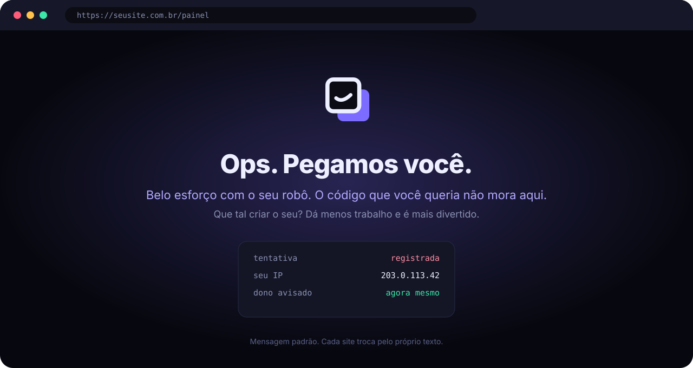

# Página sombra



É o que aparece para quem é pego. Ela fica **no mesmo endereço** que a pessoa tentou abrir: não há
redirecionamento, e o site real nunca é enviado.

## Trocar o texto

```yaml
shadow:
  language: pt-BR
  title: "Ops. Pegamos você."
  message: "Belo esforço com o seu robô. O código que você queria não mora aqui."
  footer: "Que tal criar o seu? Dá menos trabalho e é mais divertido."
  showIp: true            # mostra o IP de quem tentou, como recado
```

## Trocar o visual

```yaml
shadow:
  accentColor: "#7C6CFF"
  logo: ./minha-marca.svg
```

Quer controle total? Aponte para o seu próprio HTML:

```yaml
shadow:
  template: ./sombra.html
```

No seu HTML, use `{{ip}}`, `{{path}}` e `{{time}}` onde quiser mostrar esses dados.

O HTML precisa ser **autocontido**: o CSS dentro do próprio arquivo (num `<style>`) e as imagens em
`data:` (o `logo` acima já entra assim). A página sombra sai com a política de segurança
`default-src 'none'; style-src 'unsafe-inline'; img-src data:`, e o navegador bloqueia sem aviso
tudo o que vem de fora: folha de estilo, fonte ou imagem por endereço, e qualquer script. É de
propósito: a página sombra não busca nada nem roda nada.

## Regras que valem sempre

- Sarcasmo, sim. Ofensa, ameaça ou conteúdo discriminatório, não.
- A página sombra nunca roda nada contra a máquina de quem tentou.
- Ela não leva nenhum pedaço do site real, nem no código-fonte.
