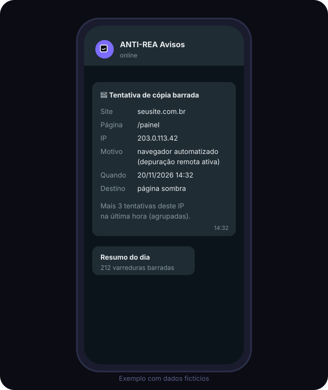

# Avisos

<div align="center">

</div>

Cada tentativa barrada pode virar um aviso com: site, página, IP, motivo, horário e destino.

## O que vira aviso e o que não vira

| Acontecimento | Padrão |
|---|---|
| REA, navegador automatizado, F12 aberto | Aviso na hora |
| Robô copiador (wget, HTTrack e afins) | Aviso na hora |
| Pedido de mapa de código ou arquivo sensível | Aviso na hora |
| Varredura genérica (`/wp-login.php`, `/.env` vindo de robô da internet) | Só no painel |

Varredura genérica acontece o dia inteiro em qualquer site público. Se virasse aviso, seu celular
não pararia. Quer um resumo diário dela? Use `scans: dailySummary`.

Tentativas repetidas do mesmo IP viram **um aviso só**, com a contagem (`groupByIp`).

## WhatsApp (pela Evolution API)

Você precisa de uma instância da [Evolution API](https://github.com/EvolutionAPI/evolution-api)
conectada a um número. Use um número só para avisos, não o seu pessoal.

No `.env`:

```bash
ANTI_REA_WHATSAPP_URL=https://sua-evolution.com
ANTI_REA_WHATSAPP_INSTANCE=avisos
ANTI_REA_WHATSAPP_TOKEN=sua-chave
ANTI_REA_WHATSAPP_TO=5511999999999
```

## Telegram

1. Crie um bot com o [@BotFather](https://t.me/BotFather) e copie o token.
2. Mande uma mensagem para o bot e descubra o seu `chat_id`.

```bash
ANTI_REA_TELEGRAM_TOKEN=123456:abc
ANTI_REA_TELEGRAM_CHAT=123456789
```

## Webhook (para integrar com o que quiser)

```bash
ANTI_REA_WEBHOOK_URL=https://seu-sistema.com/anti-rea
ANTI_REA_WEBHOOK_SECRET=um-segredo-longo
```

O ANTI-REA manda um `POST` com JSON e assina o corpo com o segredo (cabeçalho
`X-Anti-Rea-Signature`), para você conferir que veio dele.

## Sem canal configurado

O porteiro funciona mesmo assim. Ele avisa no terminal o que falta e guarda tudo no painel.
