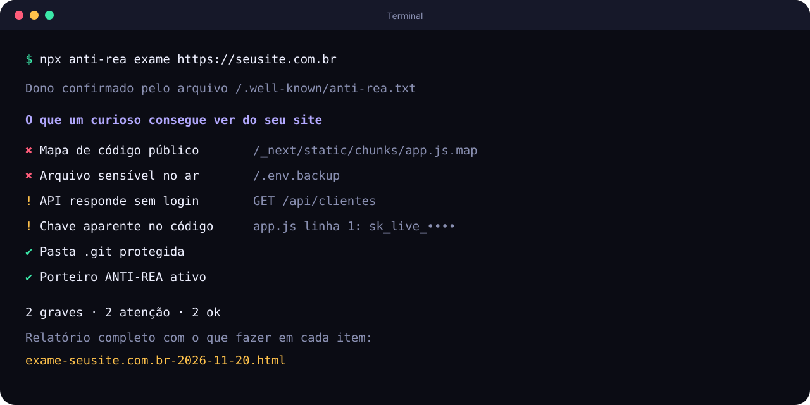

# Exame do seu site



O exame faz o que um curioso faria com uma ferramenta de engenharia reversa, só que para você ver
primeiro. Ele roda na sua máquina, não precisa do porteiro instalado e só lê.

## Como rodar

```bash
npx @jeipidevs/anti-rea exame https://seusite.com.br
```

**Na primeira vez ele pede para você provar que o site é seu.** Ele mostra uma linha assim:

```text
anti-rea=0123456789abcdef0123456789abcdef
```

Crie no site o arquivo `/.well-known/anti-rea.txt` com essa linha (no WordPress, pela pasta
`public_html/.well-known/`; no Next.js, em `public/.well-known/`) e rode o mesmo comando de novo. Sem o
arquivo, o exame não faz mais nenhum pedido ao site. É o que impede alguém de usar o exame contra o site
dos outros.

O código fica guardado no arquivo `.anti-rea-exame.json`, na pasta onde você rodou o comando. Rodando
na mesma pasta, o código não muda e o arquivo do site continua valendo.

## Com o porteiro na frente

Com o ANTI-REA na frente do site, o exame percebe o porteiro e para na porta, como qualquer
ferramenta: sem passe, o porteiro não entrega os scripts e tranca os arquivos. Ele para ali de
propósito, para não encher o seu celular de avisos.

Para examinar o site por trás do porteiro, passe o seu link de dono (sai em `anti-rea dono`):

```bash
npx @jeipidevs/anti-rea exame https://seusite.com.br --dono https://seusite.com.br/.anti-rea/dono/SEU-CODIGO
```

Com o passe de dono nada vira evento nem aviso. Os arquivos que o porteiro tranca (mapas de código,
`.env`, `.git` e afins) continuam trancados e aparecem como ok. Quer saber se eles existem no site em
si? Rode o exame contra o endereço do site sem o porteiro, de dentro da sua rede.

## O que ele procura

| Item | Como confere | Por que importa |
|---|---|---|
| Mapas de código | Abre os scripts da página inicial, segue o `sourceMappingURL` ou tenta o `.map` ao lado | Reconstroem o seu código original, com nomes e comentários |
| Arquivos sensíveis | `.env` e variações, `.git`, `.svn`, `.DS_Store`, `.npmrc`, `.htpasswd`, cópias do `wp-config.php`, backups `.zip`, `.tar.gz` e `.sql`, `phpinfo.php`. Confere pelo conteúdo, não só pelo 200: site de página única que responde a página inicial em qualquer endereço não vira alarme falso | Senhas, chaves e o histórico inteiro do código |
| API sem login | Rotas de API citadas no JavaScript (`/api/...`, `/rest/...`, `/graphql`, `/wp-json/...`), até 20 | Qualquer um lê o dado direto, sem passar pela tela |
| Chave no código | Página inicial e scripts: AWS, Stripe, GitHub, Slack, OpenAI, Anthropic, SendGrid, chave privada, `service_role` do Supabase e chave do Google (esta como atenção) | Chave no navegador é chave pública |
| Porteiro | Se o ANTI-REA responde em `/.anti-rea/guarda.js` | Sem ele, ninguém fica sabendo de quem tenta |

Uma chave achada aparece só pelo começo (`AKIAIO••••`): o relatório não vira mais um lugar de onde ela
vaza.

## Só leitura

- Só pedidos `GET`, `HEAD` e `OPTIONS`. Não existe opção para outro método.
- Só no endereço provado: script, mapa ou redirecionamento para outro domínio fica de fora.
- Rota de API com nome de ação (apagar, excluir, sair, cancelar, `logout`, `delete`, `reset`) é pulada,
  para um GET num site mal feito não mudar nada.
- No máximo 150 pedidos, 4 ao mesmo tempo, 10 segundos e 2 MB por pedido.
- Ele se apresenta como `anti-rea-exame/<versão>` no agente, para quem ler o registro do site saber
  que foi ele.

## O relatório

O terminal mostra o resumo, um item por linha (✖ grave, ! atenção, ✔ ok). Na mesma pasta sai o
arquivo `exame-seusite.com.br-AAAA-MM-DD.html`, com cada item em português claro: o que achou, por que é
perigoso e o que fazer. Abra no navegador.

> [!NOTE]
> Um item ok quer dizer que o exame não achou, não que não existe. Ele olha a página inicial e os
> scripts dela; o que só aparece depois do login fica de fora.
